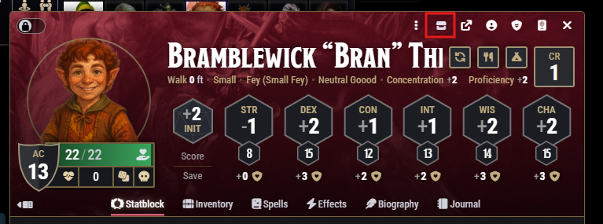
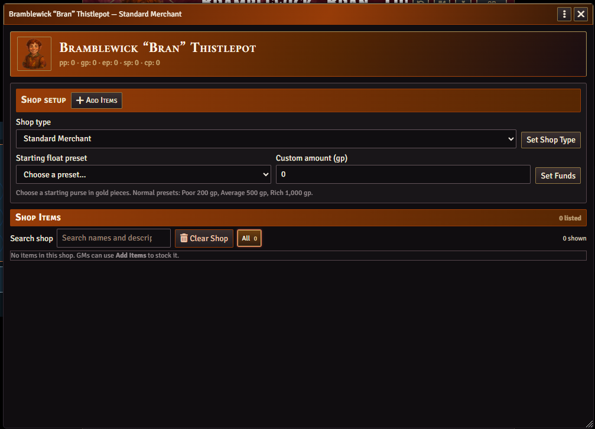
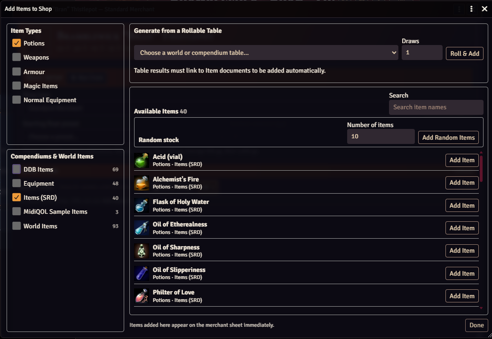
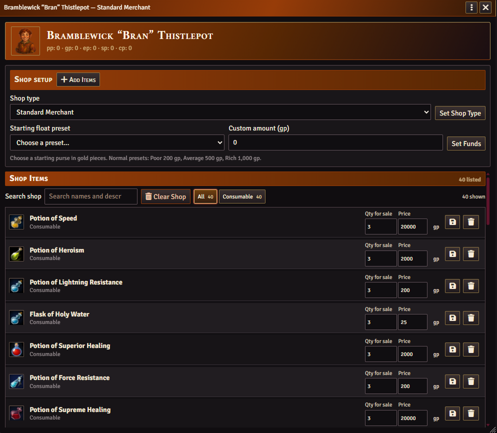
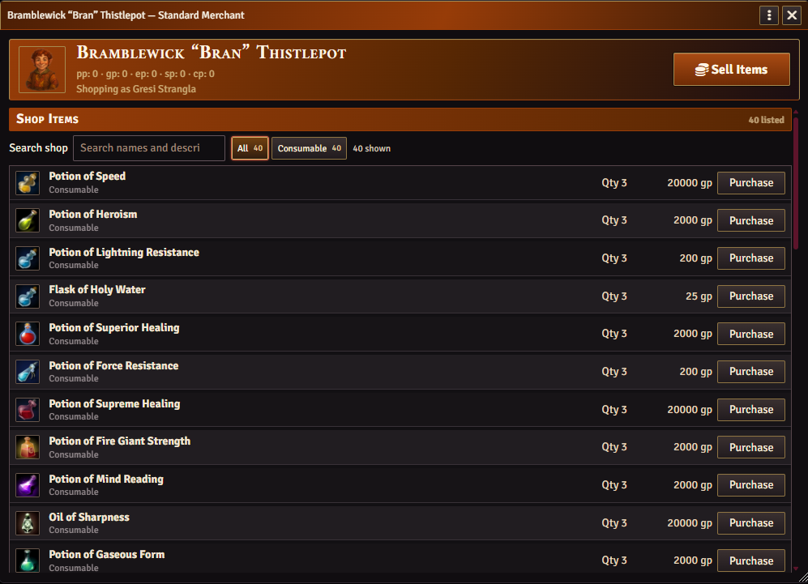

# Tinhead's Merchant NPC

Add-on module for Foundry VTT and D&D 5e

Turn an NPC into a shop your players can visit on the map. Stock the shelves from compendiums or rollable tables, then let players buy gear, sell loot, and haggle over the price.

## Installation

1. In Foundry Setup, open **Add-on Modules** and click **Install Module**.
2. Paste the URL below into **Manifest URL** and click **Install**.
3. Open your D&D 5e world and enable **Tinhead's Merchant NPC** under **Game Settings → Manage Modules**.

```text
https://raw.githubusercontent.com/Tinhead69/Tinheads-Merchant-NPC/main/module.json
```

For manual installation, extract the archive, rename the extracted folder to `merchant-npc`, and place it so the manifest is at `Data/modules/merchant-npc/module.json`. [Download the module ZIP](https://github.com/Tinhead69/Tinheads-Merchant-NPC/archive/refs/heads/main.zip)

The manifest lists Foundry v14 as verified and requires Foundry v13 or later and the D&D 5e game system version 5.0.0 or later. [Foundry's module installation guide](https://foundryvtt.com/article/modules/#installing-new-modules)

## Usage & Current Features

# GM Side Information

### Opening a Shop

As the GM, open up the NPCs character sheet and click the shop icon on the top bar; this will open up the shop interface



This icon is available to all NPCs, however it does not create a shop until this icon is clicked.

### Setting Up a Merchant

Once opened you are presented with the shop set up interface where you can decide on which type of merchant the NPC is. There are currently two options:  Standard Merchant and Jeweller.  



You can then decide what sort of monetary float the Merchant has.  This can be selected by either drop down menu or inputting a custom amount.
Standard presets are **Poor** (200 gp), **Average** (500 gp), and **Rich** (1,000 gp). Jewellers multiply the starting amount by ten. Use **Custom amount (gp)** to enter your own amount.

### Stocking the Shop

Clicking **Add Items** allows you to pull up the stocking interface.  Here you can sort items by type (to create bespoke shops if required) and select which compendiums the items need to be selected from.  There is also a function to add items from a predetermined roll table. 

When you have decided what sort of items the merchant should stock, clicking on the different installed compendiums filters the main window with the types of items available in those compendiums.  Prices are taken from the compendiums if previously inputted.



Use the shop's search and type filters to find stock. Hover over an item name to see its description. GMs can adjust quantities and prices, remove individual listings, or clear the shop.
Items that have no price are highlighted for the GMS attention. 

To change the price and quantity, change the values and then click the save icon to store the new data.
Clicking the same item multiple times will add additional units of the same item to the shop stock.

There is also the function to add random items from the selected items  It cannot add more items than are in the compendium

Once you have completed stocking the store, you can click the **Done** button in the bottom right hand corner of the window.  You are returned to the main shop interface with a list of items stocked.



#Player Side Information

### Buying Items

Characters can interact with the shop once it has been set up by double clicking on the NPC icon.  NPCs that do not have a shop set up, does not open the NPC character sheet and will not open any shop.

Highlight your character and double click on the NPC to open the store front.



The players can scroll through the shop and add 
Click **Purchase**, choose a quantity, and review the total and your character's purse before confirming. With an active GM connected, the module transfers the items and currency, updates the stock, and sends the GM a private receipt.

Items need a price before they can be purchased. Items priced at **0** require GM approval. Choose **GM chat card** or **GM pop-up dialog** under **Game Settings → Configure Settings → Merchant NPC**.

### Selling Items and Haggling

Click **Sell Items**, drag items from your character sheet into the sale window, and choose the quantities to offer. Click **Confirm Items** to send the list to the active GM, who can choose which items to buy and set a price for each.

When the offer comes back, accept it, decline it, or try **Persuasion** against the merchant's **Insight**. A successful roll gives the GM a chance to revise the offer. Once you accept, the merchant pays your character and adds the items to shop stock.

## Bug Reporting

Include your Foundry, D&D 5e, and Merchant NPC versions, along with the steps to reproduce the issue. For shop access issues, mention which token you selected and how you opened the merchant. [Report an issue on GitHub](https://github.com/Tinhead69/Tinheads-Merchant-NPC/issues)
