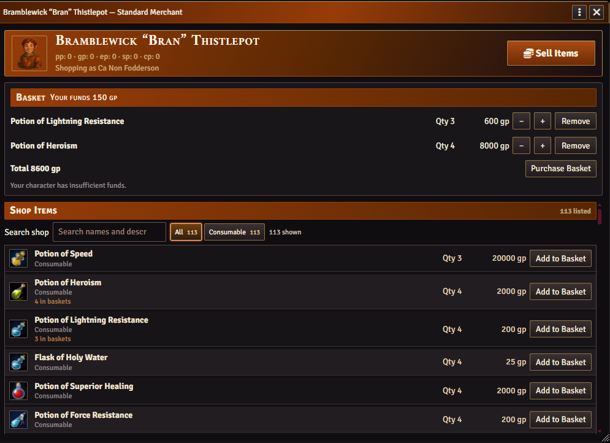
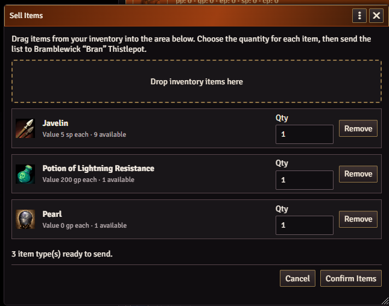

# Tinhead's Merchant NPC

Add-on module for Foundry VTT and D&D 5e

Turn an NPC into a shop your players can visit on the map. Stock the shelves from compendiums or rollable tables, then let players buy gear, sell loot, and haggle over the price.

## Installation

1. In Foundry Setup, open **Add-on Modules** and click **Install Module**.
2. Paste the URL below into **Manifest URL** and click **Install**.
3. Open your D&D 5e world and enable **Tinhead's Merchant NPC** under **Game Settings → Manage Modules**.

```text
https://raw.githubusercontent.com/Tinhead69/Tinheads-Merchant-NPC/main/module.json
```

For manual installation, extract the archive, rename the extracted folder to `merchant-npc`, and place it so the manifest is at `Data/modules/merchant-npc/module.json`. [Download the module ZIP](https://github.com/Tinhead69/Tinheads-Merchant-NPC/archive/refs/heads/main.zip)

The manifest lists Foundry v14 as verified and requires Foundry v13 or later and the D&D 5e game system version 5.0.0 or later. [Foundry's module installation guide](https://foundryvtt.com/article/modules/#installing-new-modules)

## Usage & Current Features

# GM Side Information

### Opening a Shop

As the GM, open up the NPCs character sheet and click the shop icon on the top bar; this will open up the shop interface


This icon is available to all NPCs, however it does not create a shop until this icon is clicked.

### Setting Up a Merchant

Once opened you are presented with the shop set up interface where you can decide on which type of merchant the NPC is. There are currently two options:  Standard Merchant and Jeweller.  


You can then decide what sort of monetary float the Merchant has.  This can be selected by either drop down menu or inputting a custom amount.
Standard presets are **Poor** (200 gp), **Average** (500 gp), and **Rich** (1,000 gp). Jewellers multiply the starting amount by ten. Use **Custom amount (gp)** to enter your own amount.

### Stocking the Shop

Clicking **Add Items** allows you to pull up the stocking interface.  Here you can sort items by type (to create bespoke shops if required) and select which compendiums the items need to be selected from.  There is also a function to add items from a predetermined roll table. 

Once you decide what items the merchant should stock, clicking the installed compendiums filters the main window to show the item types available in those compendiums.  Prices are taken from the compendiums if they were previously entered.


Use the shop's search and type filters to find stock. Hover over an item name to see its description. GMs can adjust quantities and prices, remove individual listings, or clear the shop.
Items that have no price are highlighted for the GMS attention. 

To change the price and quantity, update the values, then click the save icon to save the new data.
Clicking the same item multiple times adds additional units of that item to the shop stock.

There is also the function to add random items from the selected items  It cannot add more items than are in the compendium

Once you have finished stocking the store, click the **Done** button in the bottom-right corner of the window.  You return to the main shop interface with a list of stocked items.


#Player Side Information

### Buying Items

Characters can interact with the shop once it's set up by double-clicking the NPC icon.  NPCs that do not have a shop set up do not open the NPC character sheet and will not open any shop.

Highlight your character and double-click on the NPC to open the storefront.


The players can scroll through the shop and add items to a basket. This lets them check out multiple items at once. Clicking **Add to Basket** will add one item at a time.



With an active GM connected, the module transfers the items and currency, updates the stock, and sends the GM a private receipt.

Items priced at **0** require GM approval before you can add them to the basket. Choose **GM chat card** or **GM pop-up dialogue** under **Game Settings → Configure Settings → Merchant NPC**.

To complete the transaction, click **Purchase Basket**.  The items will transfer to your inventory, and the cost will be deducted from your money. If you have insufficient funds, you will be advised.

### Selling Items and Haggling

The **Sell Items** button lets players drag items from their character sheet into the sell items window and ask the Merchant to buy them.    Clicking it opens the player's character sheet and a window for items to be dropped into.  Once the player has finished adding items to sell, they click the **Confirm Items** button.



The GM gets a pop-up box telling him the player wishes to sell items to the merchant.  The GM can make an offer to the player or decline.  Prices are shown in GP, and it will accept decimals.

If the GM offers the player a price for the items, the player can accept or decline.  Players can also try to persuade the NPC to change their offer via a **try persuasion** button. If the player wants to convince the merchant the items are worth more, a persuasion skill check box appears for the player to roll.  The GM also gets a pop-up asking them to make an Insight roll.  This becomes a contested roll against the character's Persuasion.  On a player success, the GM can revise the price, if they wish, and send the revised offer back to the player.  If the NPC wins, the player is notified that they were unsuccessful in pleading their case to the NPC, and the offer is final.

The player can accept or decline the offer; the transaction will either complete (goods move to the NPC and money is added to the player) or the items will remain in the player's inventory. 


## Bug Reporting

Include your Foundry, D&D 5e, and Merchant NPC versions, along with the steps to reproduce the issue. For shop access issues, mention which token you selected and how you opened the merchant. [Report an issue on GitHub](https://github.com/Tinhead69/Tinheads-Merchant-NPC/issues)
